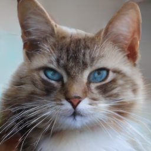
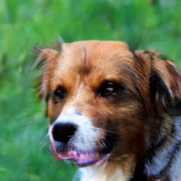
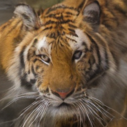

# Image Generation

Class-conditioned animal face generation using a **DiT-style Transformer**
trained with **Flow Matching** in the latent space of a pretrained
[`stabilityai/sd-vae-ft-mse`](https://huggingface.co/stabilityai/sd-vae-ft-mse) VAE.
The model generates **256 × 256** images of cats, dogs, and wild animals.

## Some results

| Cat | Dog | Wild animal |
| :---: | :---: | :---: |
|  |  |  |

## Requirements

- CUDA-compatible NVIDIA GPU
- Weights & Biases account

## Dataset

Use the following script to download the [AFHQ (Animal Faces)](https://www.kaggle.com/datasets/andrewmvd/animal-faces) dataset:

```bash
python download_animal_faces_dataset.py
```

## Training

```bash
python train.py --data_dir ./data/animal-faces/afhq/
```

| Option | Default | Description |
| --- | --- | --- |
| `--data_dir` | Required | Dataset root containing `train/` and `val/` |
| `--output_dir` | `./checkpoints` | Checkpoint directory |
| `--img_size` | `256` | Input image size; keep 256 for the current sampler |
| `--img_channels` | `3` | Image channel count; the current pipeline uses RGB images and 4-channel VAE latents |
| `--num_classes` | `3` | Class count; evaluation currently assumes the three AFHQ classes |
| `--batch_size` | `64` | Target effective batch size |
| `--micro_batch_size` | `64` | Batch size per forward pass; must divide `--batch_size`. Lower it to reduce GPU memory usage |
| `--num_epochs` | `300` | Final training epoch |
| `--lr` | `1e-4` | AdamW learning rate |
| `--T` | `200` | Number of Euler sampling steps |
| `--resume_from_checkpoint` | Disabled | Restore training state from a checkpoint |
| `--wandb_run_id` | None | W&B run ID; required when resuming |

Metrics and generated images are logged to **Weights & Biases** each epoch.
Checkpoints are saved every 50 epochs and at the final epoch to
`checkpoints/<run_id>.pt`, overwriting the previous checkpoint for that run.

Resume training with compatible parameters and a new final epoch:

```bash
python train.py --data_dir ./data/animal-faces/afhq/ \
  --resume_from_checkpoint --wandb_run_id <run_id> --num_epochs 400
```

## Project structure

- `data.py`: dataset loading and augmentation
- `train.py` / `engine.py`: training, evaluation, and checkpoints
- `diffusion_functions.py`: Flow Matching interpolation and Euler sampling
- `models.py`: DiT with 12 blocks, 12 attention heads, and adaLN-Zero conditioning
